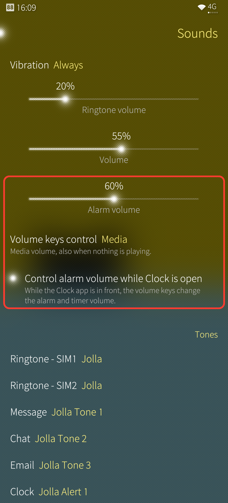
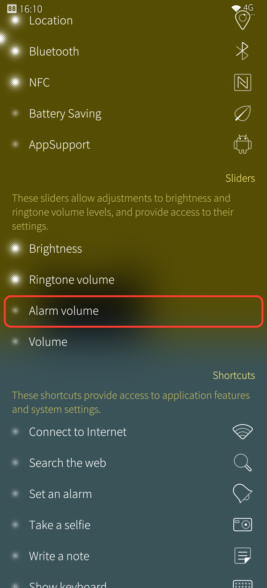
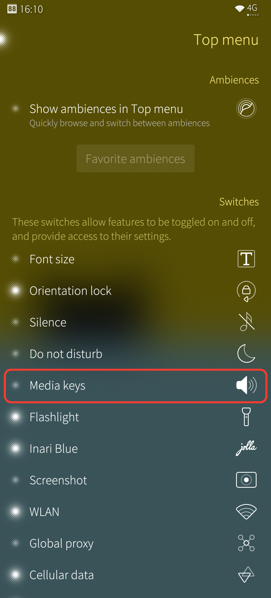

# Volume keys

A Patchmanager patch for **Sailfish OS** that lets you choose what the volume keys control and adds an **alarm volume** slider. By default the keys change the ringtone volume and only switch to media volume while something is already playing, so you can't set the level before a video starts, and alarms and timers have no volume setting at all.

Everything is in **Settings → Sounds and feedback**, below the ringtone and media volume sliders (marked in red):



- **Alarm volume:** the volume of wake-up alarms and timers (they fade in to this level). It can't go below 20 %, so an alarm is never silent.
- **Volume keys control:** **Ringtone**, **Media** (default) or **Alarm**.
- **Control alarm volume while Clock is open** (on by default): while the Clock app is in front, the keys change the alarm volume.

| | Ringtone | Media (default) | Alarm |
|---|---|---|---|
| Nothing playing | Ringtone volume | Media volume | Alarm volume |
| Media playing | Media volume | Media volume | Media volume |
| During a call | Call volume | Call volume | Call volume |

For the Top menu (Settings → Top menu) there are two items: the **Alarm volume** slider, and the **Media keys** toggle (on = Media, off = Ringtone).




Calendar reminders aren't affected: they play at the ringtone volume.

Tested on the Jolla Phone (2026), Sailfish OS 5.2.0.22.

## Install

Volume keys is a Patchmanager patch; Patchmanager 3 must be installed. Install it **either** from the [Patchmanager web catalog](https://coderus.openrepos.net/pm2/project/sailfish-media-volume-keys) **or** as an RPM, not both: both put it into the same folder (`/usr/share/patchmanager/patches/sailfish-media-volume-keys/`). To switch, remove the installed one first (see [Undo](#undo)).

If "Activate enabled patches when booting" is off in Patchmanager (the default), the patch has to be activated again after every reboot.

### From the Patchmanager web catalog

1. Settings → Patchmanager → pull down → **Web Catalog**, open **Volume keys** and tap the newest version under **Files** to install it.
2. Back in Patchmanager: activate **Volume keys**, then pull down → **Restart preloaded services** (this restarts the homescreen and closes open apps).
3. Close Settings completely and reopen it.

If version 1.x of this package (the RPM "Media volume keys") is installed, remove it first: Settings → Volume keys → **Uninstall**. Otherwise the patch can't be activated.

### As an RPM

1. Download `sailfish-media-volume-keys-<version>-<release>.noarch.rpm` from the [releases](https://github.com/lorenz-graf/sailfish-media-volume-keys/releases) on the phone and tap it in the file manager to install it (with developer mode on), or install it as root:
   ```
   devel-su pkcon install-local sailfish-media-volume-keys-<version>-<release>.noarch.rpm
   ```
2. Settings → Patchmanager: activate **Volume keys**, then pull down → **Restart preloaded services** (this restarts the homescreen and closes open apps).
3. Close Settings completely and reopen it.

**Updating from 1.x:** install the new RPM the same way. It replaces the old Settings page (Settings → Volume keys goes away), then activate the patch as in step 2. A **Media keys** toggle you had in the Top menu has to be added again.

**Updating:** install the new RPM the same way. It deactivates the patch before replacing the files, so activate it again afterwards (step 2). Your settings stay. Patchmanager doesn't show update notifications for patches installed as an RPM; new versions are on the [releases](https://github.com/lorenz-graf/sailfish-media-volume-keys/releases) page.

## Undo

- **Deactivate:** Settings → Patchmanager → Volume keys → deactivate, then **Restart preloaded services**. The volume keys and Sounds and feedback are stock again; the alarm volume stays at the level you set.
- **Uninstall:** Settings → Patchmanager → long-press **Volume keys** → **Deactivate**, then long-press → **Remove** (works for both install ways; for the RPM, Patchmanager removes the package, no password needed). Or as root: `devel-su pkcon remove sailfish-media-volume-keys`. Removing the RPM also resets the volume keys settings; the alarm volume stays at the level you set.
- **Remove the settings by hand:** `dconf reset -f /apps/sailfish-media-volume-keys/`
- **Alarm volume back to the default (100 %):**
  ```
  gdbus call --session --dest com.nokia.profiled --object-path /com/nokia/profiled --method com.nokia.profiled.set_value general clock.alert.volume '"100"'
  ```

## How it works

- **Alarm volume:** alarms and timers are played by `ngfd` (event `clock`, `/usr/share/ngfd/events.d/clock.ini`) at the profile value `clock.alert.volume` (0–100, default 100). Sailfish OS has no setting for it. The sliders read and write it over D-Bus (`com.nokia.profiled`, no root needed).
- **Volume keys:** the homescreen's volume control (`/usr/share/lipstick-jolla-home-qt5/volumecontrol/VolumeControl.qml`) decides what the keys change. The patch adds the alarm volume there (with the 20 % minimum) and reads the choice from `/apps/sailfish-media-volume-keys/target` (`ringtone`, `media` or `alarm`; not set = media) instead of the stock `/jolla/sound/force_mediavolume`. The Clock app is recognised by its window (`jolla-clock`).
- **Settings:** `/usr/share/jolla-settings/pages/sounds/SoundsPage.qml` gets the alarm slider and the options, which come from new files in `/usr/share/jolla-settings/pages/sailfish-media-volume-keys/`. The Top menu items are declared in `/usr/share/jolla-settings/entries/sailfish-media-volume-keys.json`.

Patchmanager serves the patched copies to the homescreen and Settings; nothing on disk is changed.

## Build

The patch is built from the difference between the stock files and the changed files:

- `stock/`: the unmodified files from the phone (`VolumeControl.qml`, `SoundsPage.qml`), read-only. Not in git (Jolla's code is proprietary; only the diff is published).
- `work/`: the same tree with the changes. Not in git; recreate it from the patch with `cp -a stock work && patch -p1 -d work < patch/sailfish-media-volume-keys/unified_diff.patch`.
- `settings/`: the new files (in git). `build-patch.sh` copies them into `work/`.

```
./build-patch.sh        # -> patch/sailfish-media-volume-keys/{patch.json,unified_diff.patch}
./build-rpm.sh          # -> build/sailfish-media-volume-keys-<version>-<release>.noarch.rpm
./build-catalog-zip.sh  # -> build-catalog/sailfish-media-volume-keys-<version>.zip (web catalog upload)
```

The version is `VERSION=` in `build-patch.sh` (written to `patch.json`), the RPM release is `Release:` in `rpm/sailfish-media-volume-keys.spec`. `build-rpm.sh` needs `rpmbuild` (Arch: `pacman -S rpm-tools`) and writes an rpm v4 package with a gzip payload, since Sailfish has rpm 4.16. The package's scriptlets deactivate the patch (`patchmanager -u`) before an update replaces its files and before an uninstall removes them, because Patchmanager reverses a patch with its diff.

`build-patch.sh` runs `qmllint-qt5` on every changed QML file and `check-imports.py`, which asks the phone over SSH which QML module provides each type a file uses and fails on a missing import. The phone's address comes from `PHONE=user@host` or from a file `phone.conf` (one line, git-ignored).

After a Sailfish OS update, fetch `stock/` again from the phone, rebuild and check that the patch still applies.

## License

MIT, see [LICENSE](LICENSE).
